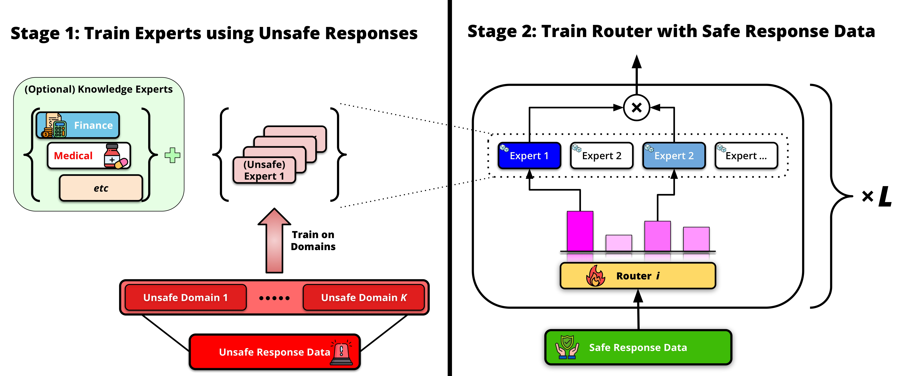

# SafeMoE

Code for $\color{purple}{\textbf{Dialectics of Alignment: Harnessing Unsafe Knowledge for Dynamic Safety Routing}}$ (NeurIPS 2026).

<p align="center">
  <a href="https://arxiv.org/abs/2606.00686"><b>Paper</b></a> · <a href="https://mhashemzadeh.github.io/safemoe-website/"><b>Project page</b></a>
</p>

SafeMoE trains one LoRA expert per harm category on *unsafe* responses
(PKU-SafeRLHF), then trains a per-layer linear router on a small set of
safe-informative responses. At inference the router mixes the top-2 experts
for every token and layer, which steers generation toward answers that are
both safe and informative.

<p align="center">
  
</p>

> This repository works with harmful prompts and responses. The unsafe LoRA
> experts are not released (see *Release policy*).

## Installation

Python 3.10 and a CUDA 12 GPU. `requirements.txt` pins every package to the
version the code was tested with:

```bash
git clone https://github.com/chandar-lab/SafeMoE.git && cd SafeMoE
python3.10 -m venv ~/envs/safemoe && source ~/envs/safemoe/bin/activate
pip install --upgrade pip
pip install -r requirements.txt   # all dependencies, pinned
pip install -e .                  # the safemoe package itself
```

Datasets and models are downloaded from the Hugging Face Hub when a script
first uses them. The LLM judge, the GPT-4 data collection and the PAIR
attacker read `OPENAI_API_KEY` / `ANTHROPIC_API_KEY` from the environment;
gated models (Llama Guard 3) need `HF_TOKEN`.

## Repository layout

```
safemoe/                  library
  moe.py                  LoRAMoeLayer, compose_safemoe, load_safemoe, routing variants
  datasets.py             every dataset of the paper, loaded by name
  training.py             tokenisation / collation for experts, routers and SFT baselines
  generation.py           model loading (base, PEFT, SafeMoE) and the evaluation decoding
  judge.py                LLM judge prompt (Appendix C), parsing and metrics
  constants.py            harm categories, expert sets (4 / L / XL), prompt templates
scripts/
  finetune.py             stage 1: LoRA experts (and SFT / dense-LoRA baselines)
  train_router.py         stage 2: router training of a SafeMoE model
  make_random_experts.py  untrained experts for the router-only control
  generate.py             response generation
  judge.py                safety / informativeness judging
  aggregate_results.py    per-category tables (mean ± std over seeds)
  data/                   GPT-4 safe-informative data collection
  eval/, analysis/, baselines/   further experiments and baselines of the paper
configs/router/           one config per model / ablation
slurm/                    example Slurm job scripts
tests/                    CPU tests on a tiny random model
```

## Method in code

`safemoe/moe.py` replaces every `gate_proj`, `up_proj` and `down_proj` of the
base model by

    h = W x + Σ_{i ∈ top-k(r)} softmax(r_top-k)_i · B_i A_i x · α/r,   r = Vᵀx

where `(A_i, B_i)` are the frozen LoRA experts and `V` (`*.gate.weight`) is the
router of the layer. Checkpoints keep the parameter names of
[mergoo](https://github.com/Leeroo-AI/mergoo).

## Data

All data is loaded by name with `safemoe.datasets.load_records` (the Hub ids
are in that file):

| Name | Use |
|---|---|
| `pku` | PKU-SafeRLHF-QA unsafe rows; `pku:<category>` selects one harm category (experts, evaluation) |
| `pubmedqa`, `fiqa`, `mental_health` | knowledge experts (Knowledge-Only, SafeMoE-XL-Knowledge); `mental_health` is gated: request access on its Hub page |
| `advbench`, `harmbench`, `harmbench_contextual`, `beavertails`, `harmfulqa`, `xstest`, `orbench_toxic`, `orbench_hard`, `truthfulqa` | evaluation benchmarks |
| `alpaca` | retain data of the unlearning baseline |
| a local `.json` / `.jsonl` / `.csv` | the GPT-4 safe responses, the Kaggle cybersecurity-qa CSV |

Harm categories use the names of the paper (Table 7, `safemoe/constants.py`),
e.g. `Drug Abuse & Weapons`, `Cybercrime`, `Psychological Harm`.

**Safe-informative router data (Appendix B).** GPT-4 answers the harmful
prompts of Drug Abuse & Weapons, Psychological Harm, Cybercrime and Economic
Crime; blanket refusals are resampled and refusal sentences are removed. The
paper uses 200 responses per category:

```bash
python scripts/data/generate_safe_responses.py --output data/safe_raw.json --per_category 200
python scripts/data/clean_safe_responses.py --inputs data/safe_raw.json --output <PATH_TO_SAFE_RESPONSES_JSON>
```

## Reproducing the paper

### 1. Experts (stage 1)

One LoRA per harm category (rank 32, α 64, lr 2e-4, 5 epochs) on the unsafe
PKU-SafeRLHF training responses of that category:

```bash
python scripts/finetune.py --data "pku:<UNSAFE_CATEGORY>" --output_dir checkpoints/experts/mistral/<category_slug>
# e.g. --data "pku:Drug Abuse & Weapons" --output_dir checkpoints/experts/mistral/drug_abuse_weapons

# Qwen2.5-3B experts
python scripts/finetune.py --data "pku:<UNSAFE_CATEGORY>" --base_model Qwen/Qwen2.5-3B --loss_on completion \
    --output_dir checkpoints/experts/qwen/<category_slug>
```

`<category_slug>` is `safemoe.constants.slug("<UNSAFE_CATEGORY>")`. The
categories of SafeMoE-4 / -L / -XL are listed in `EXPERT_SETS` of
`safemoe/constants.py`.

### 2. Router (stage 2)

```bash
python scripts/train_router.py --config configs/router/safemoe_xl.yaml data.path=<PATH_TO_SAFE_RESPONSES_JSON>
```

Top-2 routing, lr 1e-4, batch size 4, 10 epochs, AdamW. The model is saved to
`checkpoints/routers/<name>`.

### 3. Generation, judging, tables (Table 1)

```bash
for seed in 0 1 2; do
  python scripts/generate.py --model checkpoints/routers/safemoe_xl --data pku --seed $seed \
      --output_dir results/generations/safemoe_xl_seed$seed
  python scripts/judge.py --judge gpt4o --inputs "results/generations/safemoe_xl_seed$seed/*.json" \
      --output_dir results/judgements/gpt4o/safemoe_xl_seed$seed
done
python scripts/aggregate_results.py --runs results/judgements/gpt4o/safemoe_xl_seed{0,1,2}
```

`--data pku` evaluates every harm category on the PKU-SafeRLHF test split.
Generation samples with temperature 0.7 and top-p 0.9, up to 256 new tokens,
on the prompt `### Question: …\n### Answer:`. Baselines use the same command
with `--model mistralai/Mistral-7B-v0.1`, a PEFT adapter directory or any HF
model. `--judge claude` gives the Claude-Opus judge (Table 10).

Every script documents its arguments in `--help`. CPU unit tests:
`python -m pytest tests`.

## Release policy

The base models and datasets are public on the Hugging Face Hub. To avoid making
harmful capabilities more accessible, the unsafe LoRA expert weights are not
released. SafeMoE is an inference-time gating defense: bypassing the router or
merging an unsafe expert into the base model removes the protection.

## License

`safemoe/moe.py` is derived from mergoo (LGPL-3.0); the repository is released
under the same license (see `LICENSE`).

## Citation

```bibtex
@inproceedings{hashemzadeh2026dialectics,
  title     = {Dialectics of Alignment: Harnessing Unsafe Knowledge for Dynamic Safety Routing},
  author    = {Hashemzadeh, Maryam and Huang, Jerry and Kim, Minseon and C{\^o}t{\'e}, Marc-Alexandre and Chandar, Sarath},
  booktitle = {Advances in Neural Information Processing Systems},
  year      = {2026}
}
```
